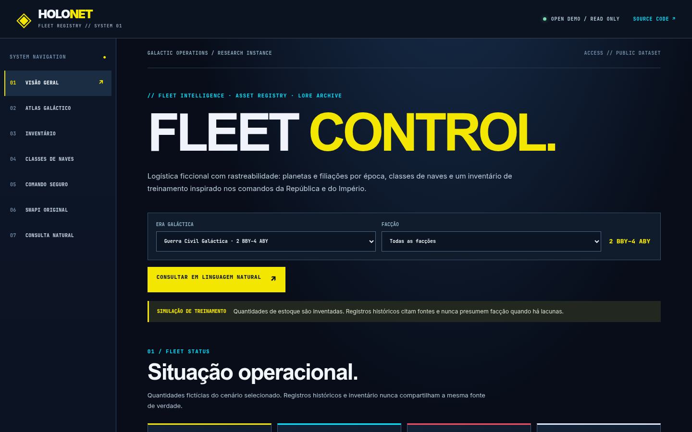
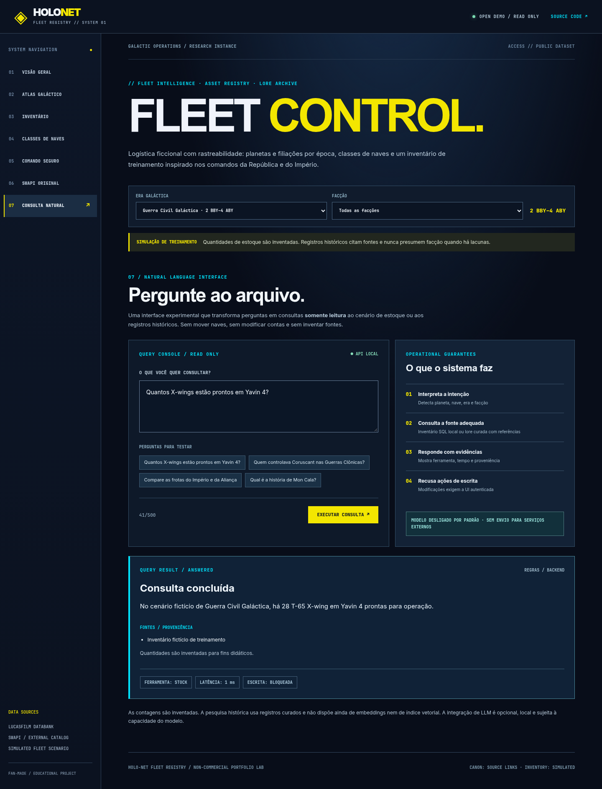

# HOLO-NET Fleet Registry

**Um laboratório de engenharia de software e IA aplicado à logística de frotas fictícias de Star Wars.**

[**Abrir demonstração pública**](https://saiiru.github.io/starwarsplanets/) · [Arquitetura e tarefas de estudo](docs/FLEET_OPERATIONS.md) · [Avaliação de consultas](docs/AI_QUERY_EVALUATION.md) · [Origem do projeto](docs/PROJECT_BRIEF.md)



O projeto começou como *Star Wars Planet Explorer*, exercício de React/Redux baseado na SWAPI. Esse módulo original permanece disponível na aba **SWAPI Original**. A expansão acrescenta uma aplicação de estoque com histórico territorial, autenticação local e perguntas em linguagem natural. O identificador do repositório `starwarsplanets` foi preservado para manter o endereço do GitHub Pages.

**O objetivo é demonstrar um problema concreto:** como consultar a disponibilidade de uma frota, comparar posições e localizar referências históricas sem confundir hipóteses, fontes e quantidades inventadas.

## O que funciona

| Subsistema | Implementação | Evidência |
| --- | --- | --- |
| Painel React | Vite, React/Redux, UI responsiva, navegação e busca | Build + testes de navegador |
| Atlas por época | Controle político e alinhamento separados por registros Canon | Testes com Coruscant, Mon Cala, Lothal |
| Catálogo SWAPI | Paginação de planetas e naves, tratamento de falhas | API externa consultada e testes |
| Simulação de estoque | Quantidade total, unidades prontas, posições e facções | SQLite local e fixtures explícitas |
| Autorização | Admin, operador por facção e leitor; sessões revogáveis | Testes de acesso negado e permitido |
| Movimentações | Transação SQL, não negatividade, idempotência e auditoria | Testes de transferência e reinício do banco |
| Perguntas naturais | Consultas determinísticas com evidência e origem | 30 perguntas de avaliação + testes de API |
| Roteamento por LLM | Modelo **opcional**, apenas em loopback, com cinco ferramentas de leitura | Testes com saída de modelo simulada; **modelo real ainda não validado** |

**As quantidades de naves são sempre ficcionais.** A simulação inicial contém, por exemplo, 36 X-wings em Yavin 4 (28 prontos) e 48 caças TIE em Lothal (37 prontos). Isso **não** é uma contagem oficial da franquia.

Os registros políticos são dependentes da era. A classificação diferencia controle territorial e alinhamento político; se não existe fonte suficiente, retorna **indeterminado**, não uma facção inventada. A curadoria inicial inclui 12 planetas e 14 classes selecionadas; a SWAPI amplia o catálogo sem criar filiações automáticas.



## Usar a demonstração

A [demonstração no GitHub Pages](https://saiiru.github.io/starwarsplanets/) é inteiramente estática. Funciona sem login, permite consultar o cenário fictício e oferece a aba **Consulta Natural**, com perguntas como:

- Quantos X-wings estão prontos em Yavin 4?
- Quem controlava Coruscant nas Guerras Clônicas?
- Compare as frotas do Império e da Aliança.
- Qual é a história de Mon Cala?

O módulo com usuário, banco e movimentações **não está exposto na internet**. No GitHub Pages, **Comando Seguro** informa como executar o backend local.

## Executar e testar

Pré-requisitos verificados: Node.js 22+, npm. O módulo de backend utiliza `better-sqlite3`, que possui binário nativo.

Frontend:

```bash
npm ci
npm test
npm run dev
npm run build
```

API, separadamente:

```bash
cd server
npm ci
npm run check
npm test
npm run eval
```

Para iniciar o servidor local, copie `server/.env.example` para `server/.env` e configure uma senha **única e forte**, não utilizada em outras contas. O arquivo está ignorado pelo Git. Em seguida:

```bash
cd server
node --env-file=.env src/start.js
```

Em outro terminal, execute `npm run dev` na raiz. O Vite encaminha apenas `/api` ao backend em `127.0.0.1:4358`. Sem a API, o frontend continua em modo de leitura estática.

O modelo local de linguagem é **opcional** e não é instalado automaticamente. A configuração e o teste de ferramentas ficam em [AI_QUERY_EVALUATION.md](docs/AI_QUERY_EVALUATION.md).

## Arquitetura

```text
                  [React + Vite]
                       |
             +---------+----------+
             |                    |
     [Leitura pública]      [API Fastify local]
       Catálogo SWAPI              |
       Lore por período        [SQLite]
       Cenário sintético        ├─ users / sessions
             |                  ├─ inventory / movements
     [Perguntas naturais]       └─ audit
             |
       [Roteador por regras]  <---- modo padrão rápido
             |
       [Modelo local opcional] ---- apenas seleção de ferramenta read-only
             |
       [Ferramenta validada: inventário / lore / comparação / modelos]
             |
       [Resposta determinística + fontes + rastreio]
```

O modelo não escreve diretamente no banco, não recebe credenciais de administrador e sua resposta livre não é considerada fonte de verdade. Operações de estoque exigem autenticação e passam por validações no backend.

## Evidências e limitações

A suíte de avaliação atualmente contém **30 perguntas escritas para o catálogo conhecido**, com casos de abstenção, injeção de prompt e bloqueio de operações. Não é um benchmark de perguntas novas ou avaliação de um LLM real. Veja os resultados gerados em `server/eval/latest-results.json`.

O mecanismo de recuperação de lore é uma busca **lexical sobre fontes curadas**, não embeddings, vector store nem RAG semântico. A etapa de IA habilitada por modelo depende de um servidor local OpenAI-compatible, mas a execução com modelo real ainda precisa de medição própria de latência e qualidade.

**Não é um ERP militar real, sistema seguro para hospedagem pública, nem produto oficial da Lucasfilm.** A interface é uma demonstração de portfólio não comercial criada por fã, com atribuição a [Star Wars Databank](https://www.starwars.com/databank) e [SWAPI](https://swapi.dev/).

## Material para estudar o código depois

Em vez de comentários didáticos espalhados pela implementação, há duas tarefas independentes:

1. [FLEET_OPERATIONS.md](docs/FLEET_OPERATIONS.md): ler o domínio, criar uma transferência de teste, avaliar papéis e justificar a transação SQL.
2. [AI_QUERY_EVALUATION.md](docs/AI_QUERY_EVALUATION.md): acompanhar uma pergunta natural até a ferramenta e a fonte, executar a avaliação, identificar limites e ativar um LLM local somente quando disponível.

O projeto é **standalone**, não integrado à KORA. A arquitetura de autorização, avaliação e consultas é reutilizável em sistemas reais de estoque de componentes, bancadas e manutenção, sem transformar os dados de Star Wars em dados operacionais reais.
