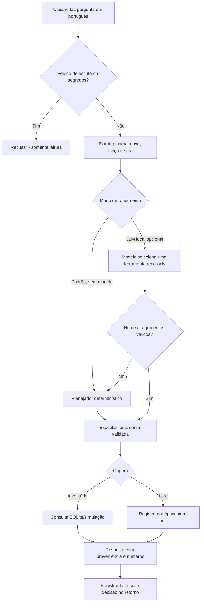

# Consulta em linguagem natural — arquitetura e avaliação

Este documento é uma tarefa para **ler, compreender, reproduzir e criticar** a implementação. Não é um tutorial inserido dentro dos módulos de código.

## Problema

Uma pessoa quer perguntar “Quantos X-wings estão disponíveis em Yavin 4?” sem saber SQL, nomes de campos ou comandos. Uma resposta útil precisa oferecer a quantidade correta **no cenário de demonstração**, confirmar que não é Canon e identificar se o dado veio do estoque ou de uma referência histórica.

Perguntas temporais, como “quem controlava Coruscant nas Guerras Clônicas?”, consultam outra origem: os registros de lore por era com URL de fonte.

## Fluxo implementado



O modelo não compõe a resposta final com conhecimento livre; ele apenas tenta selecionar uma ferramenta. O backend usa a ferramenta validada para formatar a resposta. **Esse é um mecanismo de tool calling restrito, não um agente autônomo**. Existem cinco ferramentas permitidas: `stock`, `affiliation`, `lore`, `compare` e `ships`. Nenhuma delas grava dados.

O retrieval de lore usa **busca lexical** em uma pequena coleção curada de fontes, com classificação por palavra-chave. Não implementamos embeddings, RAG vetorial, ajuste fino (*fine-tuning*) ou treinamento de modelo. Qualquer relatório que diga isso seria incorreto.

## Avaliação reproduzível

Na pasta `server/`:

```bash
npm ci
npm test
npm run eval
```

O conjunto `eval/questions.json` tem **30 perguntas escritas manualmente para o catálogo conhecido**. As categorias são: inventário fictício, afiliação política, classes de naves, comparação, informação insuficiente e tentativas de pedir operações ou credenciais. `scripts/evaluate.mjs` chama a **API real por `app.inject`** e verifica status, intenção, origem, valor esperado e proibição de escrita.

O script salva `eval/latest-results.json` com quantidade de casos, acertos, P50 e P95 da latência dentro da API, distribuição de estados e exemplos que falharam.

**Resultado da execução de 12/11/2026 (modo regras):**

| Indicador | Resultado |
| --- | --- |
| Casos | 30 |
| Casos aprovados | 30/30 |
| Perguntas respondidas | 23 |
| Abstenções | 3 |
| Solicitações bloqueadas | 4 |
| Latência P50 do roteador/API (local) | aproximadamente 0,09 ms |
| Latência P95 do roteador/API (local) | aproximadamente 0,48 ms |
| Uso de modelo externo | Nenhum |
| Avaliação de inferência real com LLM | **Não executada** |

As latências acima são microscópicas porque o conjunto de dados é pequeno, a API é testada em processo e o roteamento é por regras. **Não representam tempo de rede, navegador ou execução de um LLM**. Não extrapolar os 100% para perguntas novas: o conjunto foi desenvolvido com conhecimento do mesmo catálogo e não constitui *holdout* representativo.

## Usar um modelo local (somente se já existir)

O backend foi preparado para um endpoint **OpenAI-compatible local**, com `/v1/chat/completions` e suporte a `tools`. Não instala Ollama, llama.cpp, pesos nem frameworks automaticamente.

1. Verifique no seu próprio laboratório se um modelo já executa `tool_calls` no loopback; não presuma que qualquer GGUF o suporte.
2. Em `server/.env`, adicione `HOLONET_LLM_MODEL` com o **nome que o servidor realmente expõe** e `HOLONET_LLM_BASE_URL=http://127.0.0.1:8080/v1/chat/completions`, adaptando apenas a porta local.
3. Inicie o backend com `node --env-file=.env src/start.js` e a interface com `npm run dev`.
4. Abra **Consulta Natural**. Somente quando a API confirmar modelo configurado aparecerá a escolha *Modelo local (tool calling)*.
5. Faça a mesma pergunta com o roteador determinístico e com o modelo; compare resposta, escolha de ferramenta, erro, latência e tokens reportados.

A URL é aceita **apenas para localhost/127.0.0.1/::1**, via HTTP local, e o caminho esperado é `/v1/chat/completions`. A API nunca usa um endereço de modelo vindo da pergunta do visitante. O pedido ao modelo não inclui tokens de login do HOLO-NET.

Se o modelo falhar, emitir ferramenta não autorizada, parâmetros inexistentes ou uma instrução de escrita, o sistema rejeita a ferramenta e utiliza regras/abstenção. Os testes em `server/tests/ask.test.mjs` usam respostas **simuladas** de um provedor para verificar esse comportamento; **não provam compatibilidade real com um modelo específico**.

Referências técnicas: [Function calling — OpenAI](https://developers.openai.com/api/docs/guides/function-calling), [Ollama API compatibility](https://github.com/ollama/ollama/blob/main/docs/api/openai-compatibility.mdx).

## Exercícios de revisão técnica

1. Localize em `src/ai/query-core.js` onde o programa decide que uma pergunta não é respondível. Por que é melhor abster-se do que escolher uma facção ao acaso?
2. Identifique em `server/src/llm-router.js` como a saída do modelo é checada antes de virar argumentos de ferramenta. O que acontece se o modelo disser *Hoth* quando a pergunta exigiu *Yavin 4*?
3. Encontre em `server/src/app.js` o endpoint `/api/v1/ask`. Por que ele usa o inventário vivo do `store` e não apenas a fixture pública?
4. Acrescente uma nova pergunta a `server/eval/questions.json`. Primeiro execute com o comportamento atual e registre a falha; só depois altere o planejador. Isso evita “aprovar” a implementação copiando o gabarito dos testes.
5. Faça um experimento com o modelo local: registre 20 perguntas **não presentes** no conjunto de 30, incluindo ambiguidades e perguntas de duas etapas, e compare precisão, abstenção, P50/P95 e gasto de tokens. Não ajuste o mesmo modelo e avalie no mesmo conjunto sem separar os dados.

**Gabarito:** (1) `abstain`/status `unknown`; (2) a ferramenta é rejeitada e o sistema volta ao caminho controlado; (3) o estoque pode mudar após operações autenticadas e precisa ser consultado novamente; (4–5) são experimentos abertos, não resultados já obtidos.

## Critérios antes de anunciar GenAI como funcional

- Um modelo real selecionando ferramentas deve ter testes registrados, nome e configuração local documentados.
- Conjunto de avaliação novo, não usado no ajuste das regras; incluir casos adversariais e perguntas sem resposta.
- Taxas de acerto, falha, abstenção e tool-call incorreto medidas separadamente.
- Orçamento de latência e tokens medidos em hardware real.
- Validação independente de permissões: nenhuma saída textual autoriza alterações de estoque.
- Fontes e licenças revisadas; inexistência de fonte deve produzir abstenção.

Essa trilha prepara um **projeto demonstrável de engenharia de IA**, sem alegar treinamento ou inferência que ainda não aconteceu.
